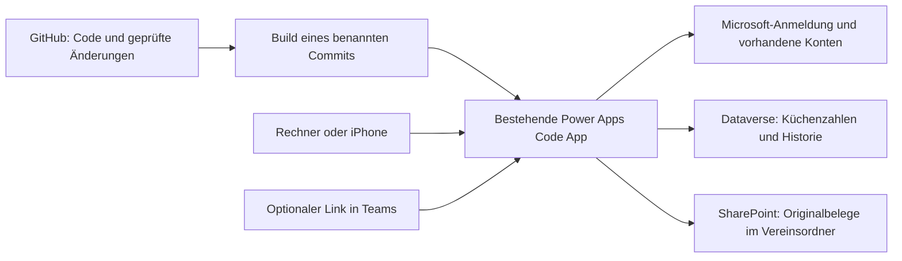

# Zunftküche: Ist- und Sollzustand

Stand: 20. Oktober 2026. Planungsgrundlage: Git-Stand `a0855d74eced69f2c412d77649bba2dc7710d226` im privaten Repository [Icarus-health/zunftkueche](https://github.com/Icarus-health/zunftkueche). Dieses Dokument beschreibt den Zielumfang; der zugehörige Entwicklungsplan zerlegt ihn in abnehmbare Lieferungen. In dieser Bestandsaufnahme wurden Quellen und vorhandene Prüfberichte gelesen, keine neue Microsoft-Anmeldung, Produktänderung oder Live-Abnahme durchgeführt.

## 1. Auftrag und verbindliche Entscheidungen

Eine moderne, verlässliche Küchenverwaltung für Zunftabende: planen, kalkulieren, einkaufen, Wareneingang und Bestand führen, Rechnungen zuordnen und den Abend auswerten. Hauptnutzer ist Sören, unterstützt durch eine weitere Person. Ein späterer Auswertungsleser wie der Säckelmeister erhält gezielt Leserechte. Die Oberfläche soll auf Rechner und iPhone angenehm bedienbar sein; die fachliche Sorgfalt einer professionellen Küche wird auf die Vereinsgröße zugeschnitten.

- Entwicklung und Versionsgeschichte liegen in GitHub; Microsoft bleibt das Betriebsziel.
- Onlinebetrieb reicht für die erste nutzbare Version. Offline-Synchronisation ist kein Abnahmekriterium.
- Keine zusätzlichen laufenden Kosten, bezahlten Dienste, Trials oder automatische kostenpflichtige Ausweichwege.
- Bestehende Microsoft-Konten, Umgebung, App und Daten bleiben erhalten.
- Teams ist ein optionaler Einstieg über einen Link. Eine Kanal-Einbettung oder ein eigenes Teams-Paket ist kein Lieferziel.
- Vorhandene Funktionen werden weiterentwickelt. Ein kompletter Neubau oder Datenbankwechsel ist nicht vorgesehen.
- Private Importe, Originalbelege, Zugangsdaten und Sicherungen bleiben außerhalb des GitHub-Repositorys.
- Fehlende Werte bleiben offen; Originale, frühere Bestellfassungen und Korrekturhistorien bleiben erhalten.

## 2. Istzustand: drei unterschiedliche Reifestufen

**Im Repository** bedeutet implementierter Quellcode. **Lokal geprüft** bedeutet nachgewiesene Tests oder Bedienung einer isolierten Testfassung. **Live geprüft** bedeutet tatsächlicher Microsoft-Host mit tatsächlichem Konto und nachgelesenen Daten. Diese Stufen werden nicht gleichgesetzt.

| Bereich | Vorhanden und belegt | Lücke bis zum Ziel |
| --- | --- | --- |
| GitHub | Privates Repository, vollständige vorhandene Git-Historie; `main` und lokaler Stand beim Upload identisch. | Noch keine eingecheckte GitHub-Actions-Prüfung, keine aktuelle zentrale Releaseübersicht. |
| Oberfläche | React/TypeScript/Vite; acht Bereiche: Übersicht, Planung, Bestellungen, Lieferungen, Belege, Auswertung, Stammdaten, Einstellungen. | Neuere Oberfläche noch nicht veröffentlicht; tatsächliches iPhone mit Kamera und Tastatur nicht abgenommen. |
| Planung und Einkauf | Artikel, Lieferanten, Rezepturen, Portionen, Anfangsbestand, Bedarf/Gebinderundung und Einkaufspositionen vorhanden. Desktopvergleich Freitag/Samstag, mobile Karten lokal geprüft. | Fachlicher Gesamtdurchlauf im neuen Microsoft-Stand offen. |
| Bestellungen und Lager | Lieferant vor Liefertag; historische Fassungen und Kontext, manuell bestellt/bestätigt, tatsächliche Liefermengen, Abweichungen und Korrekturen im Code. | Neuer Backendvertrag und tatsächliche Mehrbenutzerbedienung noch nicht live abgenommen. |
| Auswertung und Einstellungen | Verkaufsstückzahlen pro Speise/Getränk und Abend, Teilwerte, CSV, Abschluss/Wiederöffnung, persönliche Auswahl und Veranstaltungseinstellungen implementiert. Ausgewählte CSV-Downloads lokal geprüft. | Vollständiger Live-Abschluss, tatsächlicher Lesernutzer und native Druck-/PDF-Abnahme offen. |
| Microsoft | Bestehende Code App, Dataverse-Kernbestand und Konten vorhanden. Frühere Version im Browser tatsächlich auf Laden/Speichern/Neuladen geprüft; historische Rechteprüfungen vorhanden. | Neuester Quellstand unveröffentlicht. Client/Server-Protokoll 2 muss koordiniert aktiviert werden. Letzter Abbruch des Verwaltungs-Anmeldewerkzeugs ungeklärt. |
| Dateiablage | Vorhandener Vereins-Teamordner `General/Zunftküche/Rechnungen`, bestehende SharePoint-Verbindung. Frühere kleine synthetische JPEG/PDF-Rundläufe mit beiden Konten geprüft und eigene Dateien danach regulär entfernt. | Neue Dokument-/Entwurfsverwaltung samt tatsächlichen Rechten und Transaktion noch nicht live eingeführt. Historische Dateiversionssicherung offen. |
| Belegerfassung | Originalreferenzen, Upload-Wiederaufnahme, manuelle Entwürfe, Prüfplatz, bewusste Übernahme und Korrekturen implementiert. Tests prüfen Konflikte/Wiederholungen und unklare Speicherbestätigung. | Zusätzliche Dataverse-Tabellen/Schutzregistrierungen und native Übernahmeprüfung stehen aus. Kein voll abgenommener Live-Foto-bis-Rechnung-Ablauf. |
| KI/Texterkennung | Eingefügter Text kann überprüfbare Feldvorschläge liefern; Herkunft und Unsicherheit werden gespeichert. `recognitionAvailability` ist für PDF, Bild und Cloud jeweils `false`. | Keine aktive automatische Foto-/PDF-Erkennung. Ein Vorschlagsparser ist kein Rechnungs-LLM; Microsoft-KI nicht kostenlos zugesichert. |
| Sicherung | Strukturierter Sicherungsvertrag, Prüfer und isolierte lokale Wiederherstellung vorhanden. Frühere Microsoft-Inventur und lokal erhaltene Originale dokumentiert. | Aktuelle vollständige Sicherung aller neuen Speicher, Originalversionen und tatsächliche Microsoft-Wiederherstellung nicht abgenommen. |
| Entwicklerstart | Lockfiles, Tests, synthetische UI-Fixtures und lokale Vorschau vorhanden. | Normaler Start und mehrere Tests benötigen die nicht eingecheckte `import/2026.json`. `server/build.sh` erwartet Compiler und Cache außerhalb des Repositorys. Ein frischer Klon ist damit noch nicht selbstständig reproduzierbar. |
| Veröffentlichung | Microsoft-Konfiguration, generierte Dienste und umfangreiche lokale Releasewerkzeuge vorhanden. | Releasekataloge sind absichtlich leer; kein ausführbarer, abgeschlossener neuer Release. Die bisherige Werkzeugkette ist zu aufwendig und braucht einen begrenzten, dokumentierten Bedienweg. |

Quellen im Repository: `src/App.tsx`, `src/screens/`, `src/data/repository.ts`, `src/bootstrap/`, `dev/local-api.ts`, `server/build.sh`, `docs/protocol-v2-migration.md`, `server/Documents/README.md`, `tools/backup-restore/README.md`, `src/ocr/engine.ts`. Historische Entwicklungs- und Prüfberichte bleiben als datierte Belege erhalten. Veraltete Statusaussagen in solchen Dokumenten werden nicht zu aktuellen Live-Nachweisen umgedeutet.

## 3. Sollzustand: die erste alltagstaugliche Version

### Ein normaler Arbeitsabend

1. **Vorbereiten:** Veranstaltung wählen, Tage und Lieferadresse bestätigen, Speisen/Getränke und Rezepturen pflegen. Letzte Veranstaltung als Ausgangspunkt verwenden; fehlende Daten sichtbar ergänzen.
2. **Planen und kalkulieren:** Freitag und Samstag vergleichen, Portionszahlen erfassen, Bedarf samt Bestand und Gebinden nachvollziehen. Unbestätigte Rezepturen blockieren eine vermeintlich vollständige Einkaufsliste.
3. **Bestellen:** Lieferanten wählen, Liefertag wählen, Mengen und Hinweise prüfen, Fassung speichern/exportieren und tatsächliche Bestellung manuell dokumentieren. Spätere Änderungen überschreiben die bestellte Fassung nicht.
4. **Annehmen:** Tatsächliche Lieferung gegen Bestellung prüfen, Teilmenge/Ersatz/Abweichung erfassen; Rückgabe, Abfall und Berichtigungen nachvollziehbar führen. Bestellt ist nicht automatisch geliefert.
5. **Belege erfassen:** Zunächst vollständig manuell mit bewusstem Speichern. Im späteren Belegpaket Foto/PDF auswählen, Original sichern, Felder prüfen und genau einmal übernehmen. Belege buchen weder automatisch Lager noch Stammpreise.
6. **Abschließen:** Verkaufte Stückzahlen und fehlende Belege/Bestände prüfen, Teilwerte von vollständigen Ergebnissen unterscheiden, Ergebnis für einen benannten Umfang exportieren. Abschluss und Wiederöffnung haben Person, Zeitpunkt und bei Wiederöffnung einen Grund.

### Oberfläche und Bedienung

- Eine konsistente, ruhige Oberfläche mit klaren Hauptaktionen, lesbaren Status und beschrifteter Navigation.
- Rechner: vergleichende Tabellen und bei der Belegprüfung Original/Felder nebeneinander.
- iPhone: Artikelname, Tag, vollständige Menge und Einheit ohne horizontale Suche sichtbar; Eingabe auch mit geöffneter Tastatur möglich.
- Sichtbare Zustände für ungespeichert, wird gespeichert, gespeichert, Konflikt und nicht bestätigte Speicherung. Ein Klick ist noch kein Speichererfolg.
- Einstellungen trennen persönliche Ansicht von gemeinsamem Veranstaltungssetup und Verwaltungsrechten.
- Der Nutzer öffnet die App über einen gespeicherten Microsoft-Link. Ein Teams-Link kann später zusätzlich angeboten werden.

## 4. Zielarchitektur und Ablageentscheidung

Die Oberfläche kennt fachliche Vorgänge und die vorhandenen Repository-Schnittstellen. Microsoft-Host, generierte Connector-Dienste und Dateiablage bleiben in den vorhandenen Adaptern gekapselt. Lokale Demonstration verwendet ausschließlich synthetische Daten. Ein erfolgreicher lokaler Durchlauf ist notwendig; zusätzlich wird dieselbe Änderung früh im Microsoft-Host geprüft.

**Ablageentscheidung:** Der vorhandene gemeinsame SharePoint-Ordner bleibt Standard. Teams-Kanaldateien werden bereits dort gespeichert. Die App muss dafür weder im Kanal eingebettet sein noch über Teams gestartet werden. Persönliches OneDrive wäre eine zusätzliche Bindung an den Kontoinhaber; ein Wechsel bringt für die gemeinsame Vereinsablage derzeit keinen belegten Vorteil. Google Drive würde einen weiteren Anbieter und eine neue Zugriffsanbindung einführen und gehört nicht zum gewählten Microsoft-Weg. Falls mit „Drive“ die bequemere Dateiansicht gemeint war, kann die gemeinsame Ablage unabhängig vom App-Einstieg verlinkt werden.

Microsoft beschreibt den Code-App-Host als Zuständigen für Anmeldung und Laden; `power.config.json`, SDK und generierte Dienste bestimmen die Verbindungen. Ein Git-Push veröffentlicht die App nicht automatisch. Der konkrete Veröffentlichungsbefehl wird aus der bereits gepinnten CLI und ihrer Hilfe übernommen, nicht aus einer möglicherweise anderen aktuellen CLI-Version geraten. [Code-App-Architektur](https://learn.microsoft.com/en-us/power-apps/developer/code-apps/architecture), [Dateispeicher in Teams](https://support.microsoft.com/en-us/teams/files/file-storage-in-microsoft-teams).

## 5. Lieferumfang in zwei nutzbaren Paketen

**Paket A – Küchen-Kern:** Stammdaten, Rezepturen/Kalkulation, Planung, Bestellungen, Lieferungen/Lager, manuelle Belegzahlen, Verkaufsmengen, Auswertung und Einstellungen. Bestehende historische Belegreferenzen bleiben erhalten. Das neue Foto-/Entwurfssystem ist in diesem Paket serverseitig ausdrücklich nicht freigegeben und wird im UI nicht als verfügbar angeboten. Die Kernversion soll früh im Microsoft-Host funktionieren.

**Paket B – Originale und Prüfplatz:** Separate Dokument-/Entwurfsspeicher, Originalupload, Wiederaufnahme und tatsächliche Dateirechte; danach bewusste, transaktionale Belegübernahme. Automatische OCR/KI ist dafür keine Voraussetzung. Ein hochgeladenes Original ist noch keine gebuchte Rechnung.

Diese Trennung ist eine geplante Änderung gegenüber dem jetzigen Quellstand. Der aktuelle Microsoft-Bootstrap bindet die Dokumentverwaltung bereits ein; eine sichere Kernveröffentlichung setzt daher zuerst die in Plan-Aufgabe 2 beschriebene serverbestätigte Funktionsfreigabe voraus. Das ist keine bereits fertige Konfiguration. Auch Sicherung und Releaseprüfung benötigen diese Trennung: ein ausdrücklich geprüfter Kernrelease darf bei autoritativ nicht installierten Dokument-/Entwurfstabellen seinen Kernvertrag verwenden. Die ausgeschaltete Oberfläche belegt weder fehlende Tabellen noch fehlende Daten. Bereits installierte oder früher dokumenthaltige Speicher behalten ihren vollständigen Sicherungsvertrag; unbekannte oder unlesbare Speicher erlauben keine Herabstufung.

## 6. Daten- und Betriebsregeln

- Die bestehende 512-KiB-Grenze für den Küchen-Kernbestand bleibt sichtbar und wird serverseitig geprüft. Fotos, Rohtexte und Dokumenthistorien gehören in die getrennten Speicher. Eine Aufteilung nach Veranstaltung folgt erst bei gemessenem Bedarf.
- `Repository.load/commit`, `KitchenState`, `Operation`, Dokumentrepository sowie RequestJson/ResultJson bleiben die technischen Grenzen. Protokoll 1 und 2 dürfen nicht gemischt schreibend betrieben werden. Alte offene Speicheraufträge werden nicht gelöscht oder stillschweigend umgeschrieben.
- Originale und wirtschaftliche Historie werden bei Umstellung verglichen und erhalten. Wiederholte Anfragen erzeugen keine zweite Buchung; Speicherfehler dürfen nicht als Erfolg erscheinen.
- Besitzer, Bearbeiter und späterer Leser werden serverseitig unterschieden. Keine zusätzliche Identität oder Freigabe entsteht durch diesen Plan. Bestehende, möglicherweise breite Team-Dateirechte werden vor Paket B sichtbar geprüft; ein privaterer Zielordner wäre eine gesonderte Zugriffsentscheidung.
- Ein Report ist keine wiederherstellbare Sicherung. Die Oberfläche nennt gesicherte Quellen und Lücken. Eine unbekannte oder unlesbare Quelle zählt nicht als leer.
- Eine lokale Wiederherstellung belegt keine Wiederherstellung in Microsoft. Ein geeigneter separater Microsoft-Testzielort ist bisher nicht bestätigt und wird nicht stillschweigend neu angelegt. Bis zum entsprechenden Nachweis bleibt die Betriebsfreigabe ausdrücklich eingeschränkt.
- Für Tests werden die vorhandenen synthetischen Fixtures bevorzugt. Live-Tests ändern keine echten Rechnungen zu Testzwecken. Erfolgreich gebuchte Finanzprüfdaten in der bestehenden App brauchen vorher eine konkrete Lösung: entweder einen kontrolliert echten Beleg gemeinsam übernehmen oder eine ausdrücklich freigegebene, von echten Auswertungen ausgeschlossene Testveranstaltung mit erhaltener Prüfspur verwenden. Eine unveränderliche Historie wird nicht nachträglich gelöscht.

## 7. Späterer Ausbau

Nach dem nutzbaren Kern: bessere Belegvorschläge, browserseitige Texterkennung nach tatsächlichem Host-/iPhone-Nachweis, bessere Berichte, bewusst freigegebene Leser und bei Bedarf eine feinere Datenaufteilung. Copilot/AI Builder nur nach Nachweis tatsächlich verwendbarer bestehender Rechte und eines kostenfreien Aufrufwegs. Ohne solchen Nachweis bleiben sie aus. Offline-Synchronisation, Kassensystem, Teams-Sonderpaket und weitere Hostinganbieter sind keine Voraussetzung.

## 8. Abnahmekriterien

| Kennung | Nachweis |
| --- | --- |
| A1 | Frischer Klon startet mit synthetischen Daten und baut/testet ohne private Datei, Microsoft-Anmeldung oder Nachbarverzeichnis. |
| A2 | Ein Kern-Commit lässt sich im Microsoft-Host laden, berechtigt speichern und nach Neuladen unverändert lesen. Falsches Protokoll und fehlende Rechte führen zu erklärter Ablehnung. |
| A3 | Freitag/Samstag, Lieferant vor Liefertag, historische Bestellfassung und Lieferung 110 statt bestellt 120 funktionieren nachvollziehbar. Eine Korrektur 100 auf 10 bewahrt die Ausgangsbuchung. |
| A4 | Zwei vorhandene Bearbeiter behalten getrennte Veranstaltungsauswahlen; konkurrierende Änderungen führen zum erklärten Konflikt und gehen nicht still verloren. |
| A5 | Am tatsächlichen iPhone und Rechner sind die täglichen Wege bedienbar; offene Entwürfe, Tastatur, Dateiauswahl und Downloads werden tatsächlich geprüft. |
| A6 | Paket B: Originalbytes/Identität stimmen nach Wiederladen; fehlendes Dateirecht wird abgewiesen. Wiederaufnahme erzeugt keinen zweiten Upload. |
| A7 | Paket B: bewusste Übernahme erzeugt genau einen Beleg und den passenden Prüfabschluss; konkurrierende Übernahme und Fehler innerhalb der Dataverse-Transaktion erzeugen keinen Teilstand. |
| A8 | Berichte nennen Veranstaltung, Umfang, Datenrevision und offene Werte; Testdaten und nicht zugeordnete Fremdbereichskosten verfälschen kein vollständiges Küchenergebnis. |
| A9 | Sicherungsumfang, Originale und Wiederherstellungsgrenze sind explizit; begrenzte Pilotfreigabe und vollständige Betriebsfreigabe werden getrennt dokumentiert. |
| A10 | Release zeigt Commit, Client-/Serverversion, Prüfergebnisse und bekannte Grenzen. Keine zusätzlichen laufenden Kosten wurden aktiviert. |

## 9. Freigegebene Umsetzung und Pipeline

Der Nutzer hat am 20.10.2026 die Umsetzung einschließlich Pipeline freigegeben: zuerst den tatsächlichen Microsoft-Release herstellen, danach dessen Veröffentlichung aus GitHub automatisieren. Konten, bestehende Umgebung/App und kostenfreie Grenze bleiben verbindlich. Eine technische Veröffentlichungsidentität ist noch nicht eingerichtet; erforderliche neue Rechte werden am konkreten Aktionspunkt benannt. Der aktuelle Übergabestand liegt in `docs/project-status.md`, die Reihenfolge und Aufgabe 7 im Entwicklungsplan. Frühere Pläne und Berichte bleiben historische Quellen.
